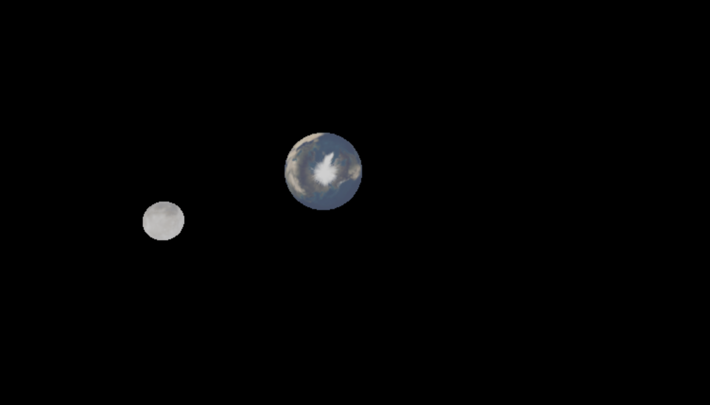
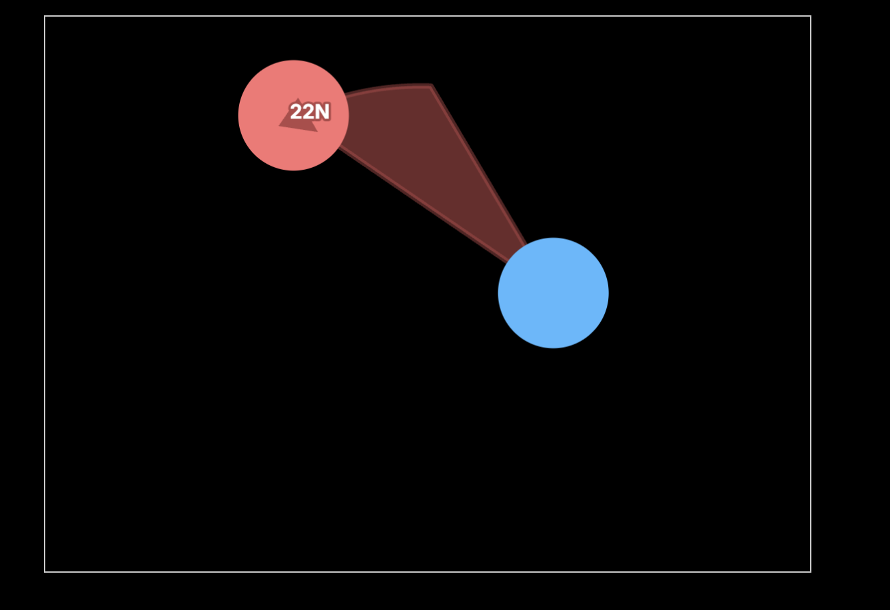

# Orbital Mechanics article

After reading some of Bartosz Ciechanowski's physics articles, I got inspired to try and make something similar on my own. I decided on orbital mechanics, a topic which I have studied briefly in the past. However, I ran out of time, so I was only able to write 2 parts.

To do this project, I learned how to use three.js and HTML canvas! With three.js, I made the initial visual, which I'm quite happy with since it shows not only the orbit but also the tidal locking:

For the rest of the simulations I used 2D HTML Canvas graphics. My favorite is this visual of kepler's second law:

It's not too good, but have a look of the website at:
https://orbital-mechanics-article.pages.dev